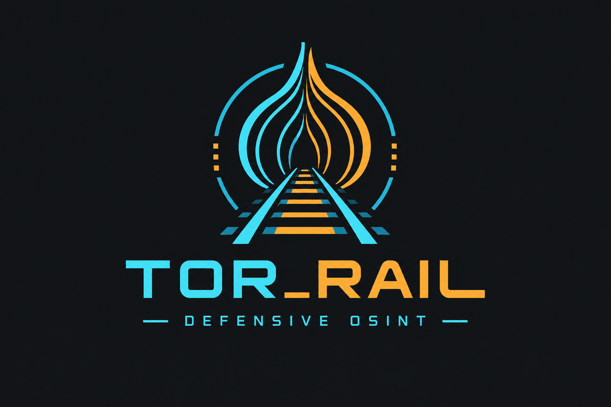

<p align="center">
  
</p>


<p align="center">
  
</p>

<h1 align="center">TOR_RAIL</h1>

<p align="center"><i>peel the dark web, layer by layer</i></p>

<p align="center">
  
  
  
  
  
</p>

**TOR_RAIL** is a menu-driven, Tor-routed OSINT console for **defensive dark-web
monitoring**. Pick a number, and it hunts public onion directories, search
engines and ransomware leak-site trackers, filters the results strictly, ranks
them by how many independent sources agree, and explains every result.

No flags to memorize, no `pip install`, no third-party packages. Pure Python
standard library.

> **Discovery and triage only.** TOR_RAIL collects public metadata. It never
> logs in, exploits, purchases, downloads or tests credentials against any
> service. See [Responsible use](#responsible-use).

---

## Highlights

- **Menu-driven.** Numbered hunts, multi-select (`1,4,5`), ranges (`1-3`), custom keywords.
- **Live sources.** Directories, clearnet and onion search engines, and ransomware leak-site tracking are queried live on every hunt. No stale saved lists.
- **Tor stealth mode.** Auto-enables when Tor is detected. All traffic goes through SOCKS5h and **fails closed**, so it never silently falls back to clearnet.
- **Corroboration score.** Every link is scored by the number of independent sources that report it.
- **Strict filtering.** Word-boundary matching (searching "Niger" never returns "Nigeria"). Every row shows why it matched.
- **Country Intel.** Guided flow over 197 countries: region, country, then what to hunt.
- **ATT&CK mapping.** Observed signals are classified into defensive themes with example MITRE ATT&CK techniques and recommended actions.
- **Export.** JSON, CSV, Markdown and TXT in one step.
- **Hardened input handling.** Remote text is sanitized against terminal injection, CSV formula injection and redirect SSRF (details below).

---

## Preview

```
  ████████╗ ██████╗ ██████╗      ██████╗  █████╗ ██╗██╗
  ╚══██╔══╝██╔═══██╗██╔══██╗     ██╔══██╗██╔══██╗██║██║
     ██║   ██║   ██║██████╔╝     ██████╔╝███████║██║██║
     ██║   ██║   ██║██╔══██╗     ██╔══██╗██╔══██║██║██║
     ██║   ╚██████╔╝██║  ██║     ██║  ██║██║  ██║██║███████╗
     ╚═╝    ╚═════╝ ╚═╝  ╚═╝     ╚═╝  ╚═╝╚═╝  ╚═╝╚═╝╚══════╝

  v3.4.0 - author: hackbytes - tor stealth routing

  Hunt:
  ┌─────┬────────────────┬─────┬───────────────┐
  │ key │ hunt           │ key │ hunt          │
  ├─────┼────────────────┼─────┼───────────────┤
  │ 1   │ Breach & Leak  │ 5   │ AI Tools      │
  │ 2   │ Russian Forums │ 6   │ Country Intel │
  │ 3   │ English Forums │ 7   │ Keyword Hunt  │
  │ 4   │ Ransomware DLS │ 8   │ Everything    │
  └─────┴────────────────┴─────┴───────────────┘

  Controls:
  ┌────────────┬──────────┬────────┬───────────┬──────────┬────────┐
  │ 9 Tor [ON] │ m ATT&CK │ h help │ r recheck │ g github │ 0 exit │
  └────────────┴──────────┴────────┴───────────┴──────────┴────────┘

  TOR_RAIL://
```

<!-- Add a real screenshot: save it as docs/screenshot.png and uncomment
<p align="center"></p>
-->

---

## Quick start

**Requirements:** Python 3.8+ and Git. Tor is optional but recommended.

```bash
git clone https://github.com/piyushshendeexe/tor_rail.git
cd tor_rail
python3 tor_railway.py
```

<details>
<summary><b>Kali / Debian / Ubuntu</b></summary>

```bash
sudo apt update && sudo apt install -y python3 git tor
sudo systemctl start tor
git clone https://github.com/piyushshendeexe/tor_rail.git
cd tor_rail && python3 tor_railway.py
```
</details>

<details>
<summary><b>Windows</b></summary>

Install Python from [python.org](https://www.python.org/downloads/) (tick
**Add python.exe to PATH**), then:

```cmd
git clone https://github.com/piyushshendeexe/tor_rail.git
cd tor_rail
py tor_railway.py
```

For Tor, keep [Tor Browser](https://www.torproject.org/download/) open
(port 9150) or use the Tor Expert Bundle.
</details>

**Tor detection:** TOR_RAIL checks `127.0.0.1:9050` (system Tor) and
`127.0.0.1:9150` (Tor Browser), then verifies through `check.torproject.org`
that the proxy really is Tor and not an SSH tunnel or VPN. Without Tor, all
clearnet sources still work and the tool tells you stealth is off.

**Other commands**

```bash
python3 tor_railway.py --version        # print version
python3 tor_railway.py --methodology    # ATT&CK-mapped signal classification
NO_COLOR=1 python3 tor_railway.py       # disable colours (also auto-off when piped)
```

---

## Usage

On launch you accept a short operator notice (type `YES`). The notice then
clears and the console starts: Tor check, source-health probe, then the menu.

### Hunts

| Key | Hunt | What it looks for |
|---|---|---|
| `1` | Breach & Leak | Data-breach and leak forums |
| `2` | Russian Forums | Russian-language hacking forums |
| `3` | English Forums | English-language hacking forums |
| `4` | Ransomware DLS | Ransomware gang data-leak sites, tracked live |
| `5` | AI Tools | AI chatbot and AI tool sites |
| `6` | Country Intel | Region, then country, then forums / markets / leak sites / DLS / AI tools / all |
| `7` | Keyword Hunt | Your own keywords |
| `8` | Everything | Runs all categories |

Select several at once: `1,4,5` or a range `1-3`.
`6` (Country Intel) runs on its own and opens a guided picker. In a
multi-select it is ignored with a notice.

### Controls

| Key | Action |
|---|---|
| `9` | Toggle and verify Tor stealth routing |
| `m` | ATT&CK mapping of observed signals |
| `h` | Help and safe workflow |
| `r` | Recheck source health |
| `g` | Project GitHub |
| `0` / `q` | Exit |

### After a hunt

```
  [1] Export (JSON + Markdown + CSV + TXT)
  [2] Liveness check via Tor
  [3] Remove dead / offline-listed entries
  [4] Filter further by keyword
  [5] New hunt
  [H] Home        [0] Exit
```

Exports are written to the `output/` folder next to the script (git-ignored by default, so scan results never get committed).

Results are ranked by **score**, the number of independent sources that
corroborate the onion. Higher score means more corroboration. Treat every
result as unverified until you confirm it yourself.

---

## How it works

| Layer | Sources |
|---|---|
| Directories | dark.fail, onion.live, tor.taxi, ransomware.live |
| Clearnet search | Ahmia, Torch |
| Onion search | 25 verified onion-only engines, queried in parallel through Tor (stealth mode) |
| Seeds | `seeds.json`: user-contributed links, always labelled **unverified** |

**Ransomware tracking.** Leak-site onions rot fast, so TOR_RAIL enumerates
group profiles on ransomware.live and reads only the first 150 KB of each page
(the profile and its leak-site links sit at the top). 400+ groups are scanned
in about a minute from clearnet, with no Tor required for discovery.

**Safety filters.** Known seized, honeypot-risk or dead entries are filtered
automatically. Directories' own `offline` / `dead` tags can be stripped in
one step.

Engines confirmed dead are excluded, and names with no verifiable current
address are never queried with guessed URLs.

---

## Stealth mode

- **Auto-on** when Tor is detected and verified.
- **Every request goes through Tor SOCKS5h.** Sites see the exit IP, DNS is resolved by Tor, and no cookies or identifying headers are sent.
- **Fail-closed.** If Tor is missing or drops, the tool refuses. It never falls back to clearnet.
- **Health probes also use Tor** while stealth is on.

Tor hides your IP from the sites you query. No tool can promise perfect
anonymity, so for the strongest setup run TOR_RAIL inside a hardened
environment such as Whonix.

---

## Defensive methodology

Observed signals are mapped to analyst-facing themes. Each theme lists
example ATT&CK techniques, what the signal does and does not prove, and
recommended defensive actions.

| Theme | Meaning for the defender |
|---|---|
| Credential exposure / data leak | Validate the claim, rotate credentials, review access logs |
| Initial-access brokerage | Check exposed remote access and identity logs |
| Ransomware extortion | Verify claims, engage incident response |
| Reconnaissance | Review external attack surface |
| Attack-enablement tooling | Track tooling trends relevant to your stack |

These labels are **hypotheses for triage**. They do not claim an attack
occurred and are not instructions for conducting one.

`watchlist.example.json` is a template for an **authorized** organization scope
(domains, brands, executives, keywords). Fill it only with assets you are
permitted to monitor.

---

## Security hardening

| Area | Protection |
|---|---|
| Terminal injection | Control characters stripped from all remote-sourced text |
| CSV formula injection | Cells starting with `= + - @` neutralized; Markdown pipes escaped |
| Redirect SSRF | Redirects to private, loopback or link-local addresses refused |
| Redirect schemes | Only `http` / `https` followed |
| Header injection | CR/LF rejected in Tor-mode URLs |
| Slow-drip DoS | Overall request deadline; bodies capped at 10 MB; engine pages truncated before parsing |
| TLS | Certificate verification enabled |
| Subprocess | Argument lists only, no shell |
| Privacy | No analytics, no telemetry. It only contacts the listed sources, when you start a hunt |

To report a vulnerability, see [SECURITY.md](SECURITY.md).

---

## Project layout

```
tor_rail/
├── tor_railway.py            # the whole tool (stdlib only)
├── seeds.json                # user-contributed seed links (unverified)
├── countries.json            # 197 countries for Country Intel
├── watchlist.example.json    # authorized-scope template
├── tor_rail-logo.png
├── CHANGELOG.md  CONTRIBUTING.md  SECURITY.md  LICENSE
└── .github/workflows/test.yml
```

---

## Responsible use

TOR_RAIL is for **threat-intel monitoring, incident response, security
research and education**. Use it only with lawful authorization, and
preserve evidence according to your incident-response policy.

- Do not open unknown services, download files or interact with listings.
- Directories can contain stale, seized, hijacked or honeypot links.
- The authors do not operate, endorse or facilitate any listed service.
- You are responsible for complying with the laws that apply to you.

---

## Contributing

Pull requests are welcome. Please keep it stdlib-only, add only sources you
have verified live (no guessed onion URLs), and never include personal data
or real case data. See [CONTRIBUTING.md](CONTRIBUTING.md).

## Changelog

See [CHANGELOG.md](CHANGELOG.md).

## Contributors

Thanks to everyone who helped shape TOR_RAIL.

<table>
  <tr>
    <td align="center">
      <a href="https://github.com/v0idR31gn">
        <br>
        <sub><b>v0idR31gn</b></sub>
      </a>
    </td>
    <td align="center">
      <a href="https://github.com/Unkown197">
        <br>
        <sub><b>Unkown197</b></sub>
      </a>
    </td>
  </tr>
</table>

Want to be listed here? Send a pull request, see [Contributing](#contributing).

## Author

Built by **hackbytes** · [github.com/piyushshendeexe](https://github.com/piyushshendeexe)

## License and attribution

Released under the **MIT License**, see [LICENSE](LICENSE).

TOR_RAIL is a transparent, modified defensive fork. It contains code and
concepts derived from the original **Allium** project by **Karan Soni**. The
original MIT license and copyright notice are preserved in `LICENSE`. TOR_RAIL
adds its own defensive methodology view, ATT&CK-oriented classification,
watchlist template, branding and interface.
